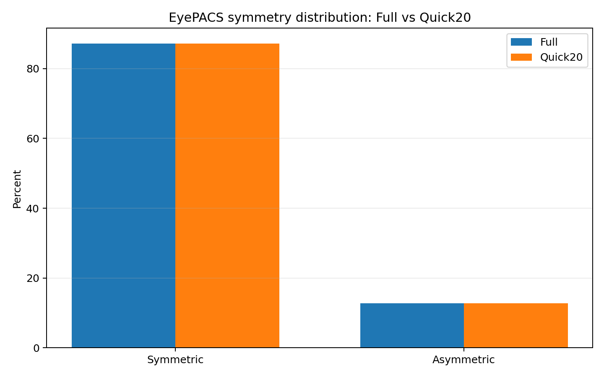
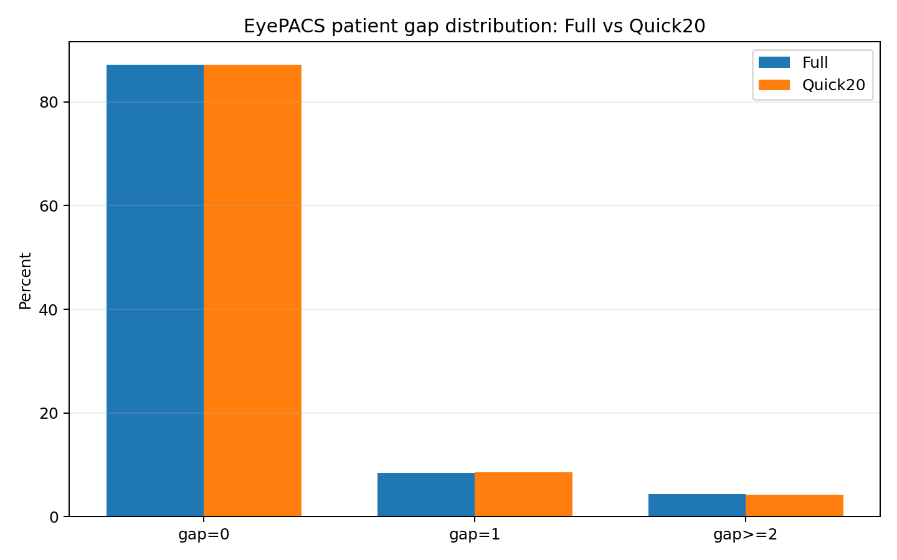
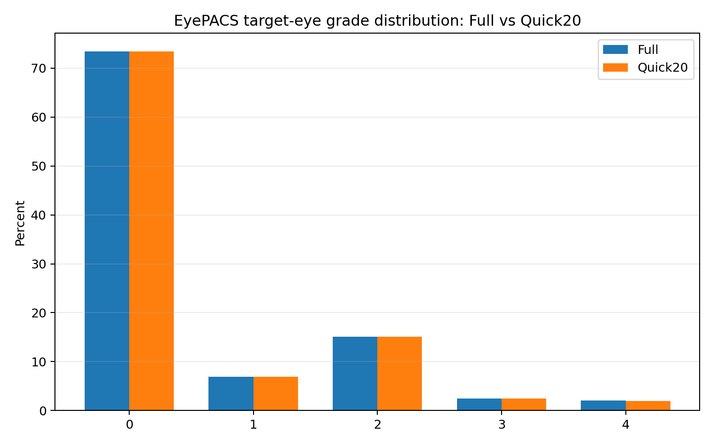

# Bilateral Diabetic-Retinopathy Benchmark

EyePACS와 Messidor-2에서 단안·양안 당뇨망막병증 등급 분류법을 동일한 quick/pilot 예산으로 비교하는 연구 저장소입니다.

> 현재 상태: **EyePACS·Messidor-2 감사 PASS / 단독·전이·허용된 조인트 pilot 완료**  
> 활성 split: `quick20_symmetry_preserved_v2`  
> 이 저장소는 현재 제안 방법(“Ours”)을 구현하거나 평가하지 않습니다.

## 왜 split을 다시 만들었나

이전 Quick20은 최대 등급과 좌우 등급 차이로 층화했지만, 원래 EyePACS 완전 양안 환자 모집단의 **Symmetric:Asymmetric 비율을 1순위 제약으로 명시적으로 보장하지 않았습니다.** 이전 split과 그 모델 결과는 현재 benchmark의 근거로 사용하지 않습니다.

새 EyePACS Quick20은 **SYMMETRY-PRESERVING PATIENT-LEVEL STRATIFIED SAMPLE**입니다.

> EyePACS quick20 was generated using patient-level stratified random sampling that preserves the Symmetric (`|L-R|=0`) vs Asymmetric (`|L-R|>=1`) ratio of the complete-pair EyePACS population.

- 환자 단위, seed 42, 비복원 추출
- 1순위: Symmetric (`gap=0`) / Asymmetric (`gap>=1`) 비율 보존
- 2순위: `gap=1` / `gap>=2`, 환자 최대 등급, 좌·우 등급 분포 보존
- Train / Validation / Test는 전체 완전 양안 환자의 약 10% / 3% / 7%
- 환자·이미지 leakage는 모두 0

## PHASE 0 — 저장소 및 환경 감사

- 로컬 저장소: `C:\Users\use\Desktop\DR-Classification`
- 원격: <https://github.com/chal07088-stack/DR-Classification>
- 브랜치: `main`
- 원본 데이터, 기존 checkpoint, 사용자 문서는 보존합니다.
- 이전 Quick20 split은 [`docs/legacy/previous_quick_split`](docs/legacy/previous_quick_split/)에 보관했습니다.
- 새 실험 출력은 split version이 포함된 별도 경로를 사용하여 과거 결과를 덮어쓰지 않습니다.

## PHASE 1 — 데이터 감사

### EyePACS

로컬 공식 `trainLabels.csv`에서 유효한 완전 좌·우 쌍만 사용해 전체 모집단 비율을 먼저 계산한 뒤 새 split을 생성했습니다.

| Split | Patients | Symmetric N (%) | Asymmetric N (%) | Gap=1 N | Gap>=2 N |
|---|---:|---:|---:|---:|---:|
| Full complete-pair population | 17,563 | 15,323 (87.2459%) | 2,240 (12.7541%) | 1,485 | 755 |
| Train | 1,756 | 1,532 (87.2437%) | 224 (12.7563%) | 150 | 74 |
| Validation | 527 | 460 (87.2865%) | 67 (12.7135%) | 45 | 22 |
| Test | 1,229 | 1,072 (87.2254%) | 157 (12.7746%) | 104 | 53 |
| Combined Quick20 | 3,512 | 3,064 (87.2437%) | 448 (12.7563%) | 299 | 149 |

Quick20의 Symmetric 비율은 전체보다 `-0.00218 percentage points`이며 정수 반올림으로 가능한 범위 안입니다.

| Hard gate | Result |
|---|---:|
| Complete L/R pairs only | PASS |
| Quick20 = 약 20% | PASS (`3,512 / 17,563 = 19.9977%`) |
| Train / Val / Test = 약 10% / 3% / 7% | PASS |
| Symmetric:Asymmetric 비율 보존 | PASS |
| Patient leakage | **0** |
| Image leakage | **0** |

상세 감사 자료:

- [PHASE 1 보고서](results/PHASE1_DATA_AUDIT.md)
- [전체 완전 양안 환자표](results/data_audit/eyepacs_full_pair_population.csv)
- [대칭비 감사표](results/data_audit/eyepacs_symmetry_sampling_audit.csv)
- [기계 판독 summary](results/data_audit/eyepacs_symmetry_sampling_summary.json)







### Messidor-2

Messidor-2는 독립적인 in-domain train/validation/test 실험과 양방향 cross-dataset transfer 평가에 사용합니다. EyePACS와 Messidor의 test split은 어떤 학습·미세조정·threshold/temperature fitting·모델 선택에도 사용하지 않습니다.

공식 L/R pairing 874개와 Kaggle Google Brain adjudicated grade CSV를 exact-ID로 결합했습니다. 로컬 이미지 1,748장·라벨 1,748행은 모두 일치했고, duplicate/unmatched ID는 0입니다. gradable 1,744장으로 complete graded pair 870개를 만든 뒤 patient-level `609 / 131 / 130` (70/15/15)으로 분할했으며 patient/image leakage는 0입니다.

## 완료된 Quick/Pilot 결과

모든 수치는 고정 seed 42, max 20 epochs, patience 4의 단일 실행 결과입니다. B3/B4는 조인트 학습을 실행하지 않았습니다.

| Training scope | B0 | B1-S | B1-P | B2-S | B2-P | B3 | B4 |
|---|---:|---:|---:|---:|---:|---:|---:|
| EyePACS test QWK | 0.684 | 0.604 | 0.636 | 0.134 | 0.454 | 0.429 | 0.012 |
| Messidor-2 test QWK | 0.810 | 0.681 | 0.724 | 0.088 | 0.311 | 0.699 | -0.020 |
| Balanced joint test QWK | 0.750 | 0.622 | 0.663 | 0.354 | 0.590 | NOT RUN | NOT RUN |

양방향 전이 14개 평가는 [`results/transfer_pilot_metrics.json`](results/transfer_pilot_metrics.json)에 있습니다. 예: B0는 EyePACS→Messidor QWK 0.741, Messidor→EyePACS QWK 0.566입니다.

## 비교 방법과 실행 순서

| Phase | ID | Method | Status |
|---|---|---|---|
| 2 | B0 | ConvNeXt-S Single | Waiting for PHASE 1 |
| 2 | B1-S | Huang 2023 matched Single | Waiting for PHASE 1 |
| 2 | B1-P | Huang 2023 PFF | Waiting for PHASE 1 |
| 3 | B2-S | DRGCNN matched Single | Waiting for PHASE 1/2 |
| 3 | B2-P | DRGCNN BFFN | Waiting for PHASE 1/2 |
| 4 | B3 | CLIP-DR 2024 | Separate EyePACS/Messidor runs; no joint run |
| 4 | B4 | AOR-DR 2025 | Separate EyePACS/Messidor runs; no joint run |

양안 Benefit/Harm은 backbone과 학습 조건이 맞는 쌍끼리만 비교합니다.

- Huang: `B1-P` vs `B1-S`
- DRGCNN: `B2-P` vs `B2-S`
- generic ConvNeXt-S(`B0`)를 양안 효과의 대조군으로 사용하지 않습니다.

공통 quick/pilot 상한은 seed 42, 최대 20 epochs, patience 4이며, DR-specific EyePACS/Messidor 사전학습 checkpoint는 금지합니다. Multi-source joint training은 dataset-balanced sampling으로 B0, B1-S, B1-P, B2-S, B2-P만 수행하며, B3/B4는 **NOT RUN BY DESIGN**입니다.

## 재현

```powershell
# EyePACS split 재생성과 감사
.\.venv\Scripts\python.exe scripts\prepare_eyepacs_quick20.py `
  --labels C:\Users\use\Desktop\pair\eyepacs_official_raw\trainLabels.csv `
  --image-root data\eyepacs\train --repo-root . --seed 42

# Messidor 공식 pairing + grade exact-ID 감사 (공식 파일 확보 후)
.\.venv\Scripts\python.exe scripts\audit_messidor_pairing.py `
  --pairing <official_pairing.csv> --grades <messidor_data.csv> `
  --left-column <left_column> --right-column <right_column> `
  --examination-column <examination_column>

# PHASE 1 두 감사가 모두 PASS한 뒤에만 실행 가능
.\.venv\Scripts\python.exe scripts\run_quick_phase2.py
```

## 주요 경로

- 활성 split: [`data/splits`](data/splits/)
- benchmark 설정: [`configs/benchmark`](configs/benchmark/)
- 데이터 감사: [`results/data_audit`](results/data_audit/)
- 실행 스크립트: [`scripts`](scripts/)
- benchmark 코드: [`src/drpair/benchmark`](src/drpair/benchmark/)
