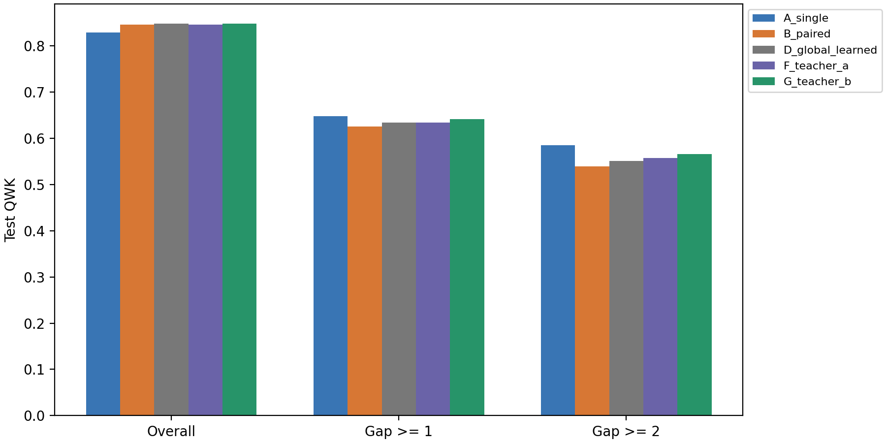

# DR-Classification

비대칭 환자에서 양안 융합이 어느 등급 경계를 해치는지 분석하고, 해당 경계만 단안 예측으로 되돌리는 연구 코드입니다.
현재 버전은 **EyePACS / ConvNeXt-S**의 PHASE 1A·1B와 PHASE 2A 다중-seed 재현성 검증 완료 상태입니다.
PHASE 1에서 final expert, validation 진단, train expert OOF 및 사전 고정한 A–G 방법의 test 평가를
완료했고, PHASE 2A에서 seed 42·123·128의 final expert와 Gate를 각각 다시 학습했습니다.

> **현재 상태:** PHASE 2A 완료. 외부 비교·추가 분석과 PHASE 3은 자동으로 시작하지 않습니다.

## PHASE 1 실험 결과

### 실험 설정과 단계

- 데이터: EyePACS official train 35,126 eyes / validation 10,906 eyes / test 42,670 eyes
- 단위: 환자 단위 분할, validation gate 5-fold cross-fitting, patient bootstrap 1,000회
- 공통 모델: ConvNeXt-S, 512px RGB, ordered-CORAL, seed 42
- PHASE 1A: final single·paired expert 학습 후 validation에서 비대칭 현상과 gate headroom 진단
- PHASE 1B: train expert OOF 생성, Teacher A/B 분석, validation에서 gate 학습, 고정된 A–G를 test에서 1회 평가

Test를 보기 전에 `G_teacher_b`를 제안 방법으로 고정했습니다. 따라서 아래 A–G는 test 결과를 보고
유리한 방법을 사후 선택한 목록이 아닙니다.

### PHASE 1A: final expert와 validation 진단

PHASE 1A의 질문은 **“양안 융합이 평균적으로는 유리하지만, 양안 등급 차이가 큰 환자에서는
해로워지는가?”**였습니다.

| Validation QWK | Single | Paired | Fixed 50:50 |
| --- | ---: | ---: | ---: |
| Overall | 0.8339 | **0.8523** | 0.8433 |
| Gap = 0 | 0.8711 | **0.8961** | 0.8844 |
| Gap = 1 | 0.7022 | **0.7072** | 0.7062 |
| Gap >= 1 | **0.6290** | 0.6120 | 0.6229 |
| Gap >= 2 | **0.5313** | 0.4880 | 0.5153 |

Raw prediction의 paired-minus-single QWK는 overall에서 `+0.0184`
(95% CI `[+0.0099, +0.0267]`)였지만, Gap >= 2에서는 `-0.0433`
(95% CI `[-0.0895, -0.0064]`)였습니다. Gap >= 1의 raw CI는 0을 포함했지만,
Platt·isotonic calibration 후에는 두 비대칭 strata 모두 paired의 열세가 확인되었습니다.

Label-aware 16-mask/625-grid 진단은 학습 모델이 아니라 **회수 가능한 headroom을 확인하는 진단 도구**입니다.
Raw 기준 291명(322 eyes)이 이산 rollback으로 이득을 보았고, Gap >= 2에서는 57명(61 eyes)의
평균 squared-error recovery가 0.2891이었습니다. 이 결과는 continuous gate의 상한이나 test 성능이 아닙니다.

Fellow grade가 target grade보다 높을수록 paired prediction이 single보다 높은 쪽으로 이동하는
grade-adjusted association도 관찰됐습니다(raw slope 0.0792, 95% CI `[0.0647, 0.0936]`,
permutation `p=0.001`). 이는 **모델의 shrinkage 반응에 대한 기술적 연관성**이며 임상적 인과 증거는 아닙니다.

상세 결과: [PHASE 1A report](experimental_results/phase1_convnext_s_seed42_staged_v1/diagnostics/phase1a/REPORT.md),
[QWK bootstrap](experimental_results/phase1_convnext_s_seed42_staged_v1/diagnostics/phase1a/qwk_deltas.csv),
[headroom](experimental_results/phase1_convnext_s_seed42_staged_v1/diagnostics/phase1a/headroom.csv)

### PHASE 1B: Teacher A/B gate와 고정 A–G test

| Arm | 방법 | Overall | Gap >= 1 | Gap >= 2 |
| --- | --- | ---: | ---: | ---: |
| A | Target-eye single expert | 0.8298 | **0.6478** | **0.5857** |
| B | Bilateral paired expert | 0.8462 | 0.6260 | 0.5393 |
| C | 고정 50:50 single/paired 혼합 | 0.8410 | 0.6439 | 0.5791 |
| D | 환자별 global rollback weight 하나 | 0.8483 | 0.6347 | 0.5511 |
| E | Boundary gate를 ordinal task loss로 직접 학습 | **0.8485** | 0.6385 | 0.5623 |
| F | Teacher A: local BCE loss-guided gate | 0.8465 | 0.6339 | 0.5571 |
| G | Teacher B: one-boundary counterfactual ordinal gate (proposed) | 0.8481 | 0.6416 | 0.5656 |

Test는 21,335 patients(42,670 eyes)이며 Gap >= 1은 2,678명, Gap >= 2는 889명입니다.
Single은 paired보다 overall QWK가 0.0165 낮았지만, Gap >= 1에서는 0.0217,
Gap >= 2에서는 0.0464 높았습니다. 세 patient-bootstrap CI 모두 0을 포함하지 않았습니다.
즉 **paired fusion은 전체 성능을 높이는 대신 비대칭 환자에서 손실을 지불한다**는 PHASE 1A의
현상이 독립 test에서도 재현됐습니다.

제안 G는 paired B 대비 다음과 같이 개선됐습니다.

| G minus Paired | QWK delta | Patient-bootstrap 95% CI |
| --- | ---: | ---: |
| Overall | +0.00187 | `[+0.00029, +0.00340]` |
| Gap >= 1 | +0.01557 | `[+0.01068, +0.02068]` |
| Gap >= 2 | +0.02630 | `[+0.01701, +0.03599]` |

개선 폭은 양안 비대칭이 커질수록 증가했습니다. G의 overall accuracy는 0.8495,
MAE는 0.1887로 paired의 0.8491/0.1901보다 소폭 개선됐습니다.



### Teacher A와 Teacher B가 말하는 것

Teacher A는 각 boundary의 single/paired BCE를 비교해 single의 local probability loss가 더 작으면
rollback target을 부여합니다. Teacher B는 paired의 boundary 하나만 single 값으로 교체한 뒤
PAVA와 ordinal decoding을 수행하고, **실제 최종 grade squared error가 감소할 때만** rollback utility를 부여합니다.

| Validation active targets | B0 | B1 | B2 | B3 |
| --- | ---: | ---: | ---: | ---: |
| Teacher A | 4,354 | 4,460 | 4,552 | 4,747 |
| Teacher B | 146 | 97 | 65 | 31 |

Teacher B는 최종 grade를 바꾸는 드문 개입만 선택했으며, test에서 F보다 G가 높았습니다:
overall `+0.0016`, Gap >= 1 `+0.0077`, Gap >= 2 `+0.0085` QWK.
이는 local probability 비교보다 **최종 ordinal decision을 기준으로 만든 supervision이 더 적합했다**는 근거입니다.

다만 G의 test 평균 alpha는 B0–B3에서 각각 0.0155, 0.0122, 0.0104, 0.0073으로 매우 보수적이었습니다.
즉 대부분의 경우 paired fusion을 유지하고, 작은 확률 변화가 PAVA/0.5 decoding 경계에 영향을 주는
일부 사례에서만 성능을 회수했습니다.

### 결론과 해석 범위

PHASE 1은 다음 두 주장을 지지합니다.

1. 양안 융합은 전체적으로 유리하지만 inter-eye grade gap이 커지면 conditional fusion harm이 발생합니다.
2. One-boundary counterfactual supervision으로 학습한 boundary-wise rollback gate는 paired 대비
   전체 성능을 보존·개선하면서 비대칭 strata의 손실을 유의하게 완화합니다.

그러나 G가 모든 비교군을 압도한 것은 아닙니다. Overall 최고는 E(0.8485)였고 G(0.8481)와의 차이는 작았습니다.
비대칭 strata에서는 single과 fixed 50:50이 G보다 높은 구간도 있습니다. 또한 현재 결과는 seed 42 하나이므로
training-seed 변동, 외부 데이터 일반화 및 다른 backbone에 대한 결론은 PHASE 2/3에서 확인해야 합니다.

전체 결과: [PHASE 1 report](experimental_results/phase1_convnext_s_seed42_staged_v1/REPORT.md),
[A–G metrics](experimental_results/phase1_convnext_s_seed42_staged_v1/metrics/arm_metrics.csv),
[bootstrap CI](experimental_results/phase1_convnext_s_seed42_staged_v1/metrics/paired_bootstrap_ci.csv),
[alpha summary](experimental_results/phase1_convnext_s_seed42_staged_v1/metrics/alpha_summary.csv)

## PHASE 2A 다중-seed 재현성 결과

PHASE 1에서 고정한 EyePACS / ConvNeXt-S 프로토콜을 변경하지 않고 seed 123과 128을 추가했습니다.
각 seed에서 final single·paired expert와 validation-crossfit Gate를 새로 학습했으며, 아래 값은
seed 42·123·128의 test QWK 평균과 표본 표준편차입니다.

| Arm | 방법 | Overall | Gap >= 1 | Gap >= 2 |
| --- | --- | ---: | ---: | ---: |
| A | Target-eye single expert | 0.8282 +/- 0.0024 | **0.6463 +/- 0.0043** | **0.5837 +/- 0.0065** |
| B | Bilateral paired expert | 0.8447 +/- 0.0032 | 0.6254 +/- 0.0091 | 0.5376 +/- 0.0112 |
| C | 고정 50:50 single/paired 혼합 | 0.8386 +/- 0.0032 | 0.6408 +/- 0.0063 | 0.5722 +/- 0.0097 |
| D | 환자별 global rollback weight 하나 | 0.8466 +/- 0.0021 | 0.6328 +/- 0.0028 | 0.5474 +/- 0.0035 |
| E | Boundary gate를 ordinal task loss로 직접 학습 | **0.8479 +/- 0.0024** | 0.6383 +/- 0.0037 | 0.5602 +/- 0.0051 |
| F | Local BCE loss-guided gate | 0.8447 +/- 0.0032 | 0.6326 +/- 0.0070 | 0.5516 +/- 0.0093 |
| G | Counterfactual ordinal supervision gate (proposed) | 0.8462 +/- 0.0029 | 0.6394 +/- 0.0058 | 0.5627 +/- 0.0092 |

G는 세 seed 모두 paired B보다 높았습니다. 평균 개선량은 overall `+0.0015`, Gap >= 1
`+0.0140`, Gap >= 2 `+0.0251` QWK로, 비대칭이 커질수록 rollback의 이점이 증가하는 경향이
반복됐습니다. G는 local BCE gate F보다도 세 지표에서 평균적으로 높았습니다.

해석에는 한계가 있습니다. Overall 최고는 E였으며 G보다 `0.0017` 높았습니다. G는 학습형
adaptive 방법 중 비대칭 strata 평균이 가장 높았지만, single A와 fixed 50:50 C가 일부 비대칭
지표에서 더 높았습니다. 따라서 현재 결과는 **G가 모든 비교군을 압도한다**기보다, paired의
overall 이점을 대부분 유지하면서 conditional fusion harm을 일관되게 완화한다는 주장을 지지합니다.
세 seed만으로 방법 간 training-seed 유의성을 확정하지 않으며, patient bootstrap은 각 seed의
표본 불확실성을 나타낼 뿐 seed 변동을 대체하지 않습니다.

상세 결과: [PHASE 2A aggregate report](experimental_results/phase2_multiseed_v1/REPORT.md),
[seed별 QWK](experimental_results/phase2_multiseed_v1/metrics/per_seed_qwk.csv),
[평균 및 표준편차](experimental_results/phase2_multiseed_v1/metrics/multiseed_summary.csv)

## 코드 위치

| 작업 | 실제 코드 |
| --- | --- |
| 단안·양안 ConvNeXt-S | [models/experts.py](src/drpair/models/experts.py) |
| Ordered-CORAL head | [models/ordinal.py](src/drpair/models/ordinal.py) |
| 이미지·환자 분할·5-fold | [data/](src/drpair/data/) |
| 학습·EMA·예측 저장 | [training/](src/drpair/training/) |
| Teacher A / **one-boundary Teacher B** | [teachers/targets.py](src/drpair/teachers/targets.py) |
| Gate 입력·네트워크·학습 | [gates/](src/drpair/gates/) |
| 지표·환자 bootstrap·local/joint 효과 | [evaluation/](src/drpair/evaluation/) |
| 1A calibration·headroom·임상 경계 진단 | [evaluation/feasibility.py](src/drpair/evaluation/feasibility.py) |
| 환자 cross-fitting calibration | [evaluation/calibration.py](src/drpair/evaluation/calibration.py) |
| 단계별 실행과 검토 경계 | [experiments/stages.py](src/drpair/experiments/stages.py) |
| 실행 단계·비교군 정의 | [experiments/](src/drpair/experiments/) |
| 검증 테스트 | [tests/](tests/) |
| 아이디어 원문 PDF | [docs/papers/research/](docs/papers/research/) |
| 확정한 방법과 PDF 해석 | [docs/research_protocol.md](docs/research_protocol.md) |

## 설치와 데이터

Python 3.12, NVIDIA CUDA 12.8용 PyTorch 환경입니다. 의존성은 `pyproject.toml`과 **`uv.lock`**으로 관리합니다.
Conda 환경 YAML은 사용하지 않습니다. uv 자체가 없다면 [공식 설치 안내](https://docs.astral.sh/uv/getting-started/installation/)를 따릅니다.

```sh
uv sync --locked
uv run --locked drpair --help
uv run --locked dvc remote add --local --default local /path/to/dvc-store
uv run --locked dvc pull data/eyepacs.dvc
uv run --locked drpair prepare
uv run --locked pytest -q
```

이 PC에서는 `pair/dvc-store`가 로컬 DVC 저장소로 설정되어 있습니다.
원본 이미지 88,702장은 Git에 들어가지 않고 `data/eyepacs.dvc`가 내용을 추적합니다.
Git에는 상대 경로·환자 ID·라벨·fold가 담긴 [분할 CSV](data/splits/eyepacs.csv)도 포함됩니다.

다른 PC가 `dvc pull`하려면 이 로컬 저장소에 접근할 수 있어야 합니다.
공유 NAS/S3/SSH 저장소가 생기면 그 주소를 설정하고 데이터를 `dvc push`합니다.
현재 로컬 하드링크는 디스크 공간을 아끼는 연결이며 별도 물리 백업은 아닙니다.
데이터 등록·복원 방법은 [data/README.md](data/README.md)에 있습니다.

## 실행

아래 명령은 **사용자가 실행할 때만** 학습을 시작합니다. 설치·prepare·status는 학습하지 않습니다.

```sh
uv run --locked drpair status
uv run --locked python scripts/run_phase1.py --stage 1a
```

PHASE 2A는 PHASE 1의 seed 42에 seed 123·128을 추가하는 locked-protocol 재현성 실험입니다.
각 seed에서 final single/paired expert와 validation-crossfit gate를 다시 학습한 뒤, 세 seed의
test QWK를 평균과 표준편차로 집계합니다.

```sh
uv run --locked python scripts/run_phase2.py
```

현재 gate는 official validation에서 patient-level cross-fitting하므로 PHASE 2A에서는 train expert OOF를
반복하지 않습니다. 이 선택은 계산량을 줄이기 위한 사후 생략이 아니라 [PLAN.md](PLAN.md)에 사전 기록된
프로토콜이며, seed별 final expert·Gate·test prediction은 모두 새로 생성합니다.

RTX 5070 Ti 한 장에서는 각 expert fit이 약 8.8 GiB를 사용하므로 두 GPU 학습을 동시에 실행하지 않습니다.
Seed 123과 128을 순차 실행해 VRAM 충돌을 막고, 각 학습 내부에서는 DataLoader worker 6개, BF16,
channels-last, pinned memory와 prefetch를 사용합니다.

1A는 **선택 학습 2회 + 전체 train refit 2회 = 최대 4회 학습**입니다.
각 expert는 공식 train 내부에서 epoch를 결정하고 전체 train에 refit합니다.
`inner_validation_fraction=0.1`은 내부 검증 비율입니다. 선택 학습에는 약 90%를 사용합니다.
먼저 두 expert의 선택 학습을 완료해 내부 경계 진단을 남기고 이어 두 refit을 수행합니다.
0.5에서 B3 예측이 없다는 이유만으로 자동 중단하지 않고 calibration과 ranking을 함께 보고합니다.
공식 validation 이미지만 예측하며 1A는 test 이미지 추론을 수행하지 않습니다.

공식 validation 5-fold 안에서 Platt/isotonic calibration과 임상 작동점을 적합·평가합니다.
Binary 16-mask와 alpha 5값의 625개 조합을 조사하고 환자 bootstrap을 기록합니다.
두 값은 label-aware 진단이며 **연속 gate의 절대 상한이나 학습 모델 성능이 아닙니다**.
Raw-feature logistic probe는 local Teacher B의 양의 utility 예측 가능성을 보는 저비용 진단입니다.
완료된 실행에서는 이 검토 뒤 PHASE 1B의 Teacher A/B gate 학습으로 진행했습니다.

결과는 `diagnostics/phase1a/REPORT.md` 및 CSV·JSON·PNG·PDF·NPZ에 저장됩니다.
1A만 재실행하면 보고서를 생성한 뒤 상태는 `awaiting_review`가 되고 프로세스가 종료됩니다.
QWK +0.005 같은 자동 합격선은 없습니다. 전체·gap별 효과, 표본 수, calibration과 신뢰구간을 검토합니다.

1A 검토 후 1B를 명시적으로 재현할 때는 아래 명령을 사용합니다.

```sh
uv run --locked python scripts/run_phase1.py --stage 1b --reviewed-1a
```

1B는 expert OOF 10개를 위한 선택 학습 10회와 refit 10회를 추가합니다.
그 뒤 보존된 final expert의 test 예측, validation-crossfit Teacher A/B gate, A-G 보고서를 생성합니다.
제안 방법은 G_teacher_b이며 test를 보고 A/B 중 하나를 선택하지 않습니다.
완료된 본실험도 이 승인 경계를 지켰으며, 1B가 1A에서 자동 시작되지는 않았습니다.

완료한 job은 같은 코드·config·manifest인 경우 체크포인트를 재사용합니다.
체크포인트 파일 자체에도 학습/검증 행 구성·config·코드 지문을 저장하고 다르면 로딩을 거부합니다.
중단된 epoch의 optimizer 자동 재개는 구현하지 않았으며, 미완료 job은 처음부터 다시 학습합니다.

동일 run의 중복 실행은 lock으로 막고 오류가 나면 중단하여 `execution_status.json`에 기록합니다.
Windows에서는 실행 중 시스템 자동 절전만 막으며 화면 켜짐은 강제하지 않습니다. 예약 작업은 아닙니다.

설정은 [configs/phase1.toml](configs/phase1.toml)에 있습니다.
RTX 5070 Ti 사전 측정에 따라 단안 B16 x 2 / 양안 B8 x 4 / effective batch 32 /
512px RGB / BF16 / channels-last / workers 6을 사용합니다. PyTorch allocator 상한은 13 GiB입니다.
측정 원본은 `experimental_results/gpu_preflight/`에 있으며 성능 비교 결과가 아닙니다.
학습 진행률과 VRAM peak는 각 job의 `logs/*.progress.json` 및 표준 출력에 기록합니다.
각 선택 epoch의 B0-B3 사건 수·recall·AUC/AP는 `logs/*.boundaries.json`과 JSONL에 기록합니다.
내부 선택 집합 진단은 `diagnostics/initial_expert_check.json`이며, 최종 1A 판단 자료는 `diagnostics/phase1a/`입니다.
실제 epoch의 처리량·DataLoader 대기·validation 시간도 기록하므로 짧은 preflight 속도를 ETA로 단정하지 않습니다.

## 결과

실제 실행 결과는 `experimental_results/<run_name>/` 한 곳에 모입니다.
`checkpoints`, `predictions`, `features`, `teachers`, `gates`, `logs`, `metrics`, `figures`, `REPORT.md`는 실행 시 생성합니다.
작은 CSV·JSON·리포트는 Git에, 큰 NPZ·체크포인트는 DVC에 기록합니다.
현재 `experimental_results/repository_validation/`은 설치·코드·데이터 검증 기록이며 성능 결과가 아닙니다.

Teacher B supervision은 각 경계의 `U_b`입니다. 실제 joint mixing 효과는 별도로 보고하며
16-mask oracle은 분석 전용입니다. 1A와 1B 보고서 뒤에는 자동으로 다음 실험이 시작되지 않습니다.
다중 seed·외부 데이터·추가 backbone 순서는 [PLAN.md](PLAN.md)에 있습니다.
