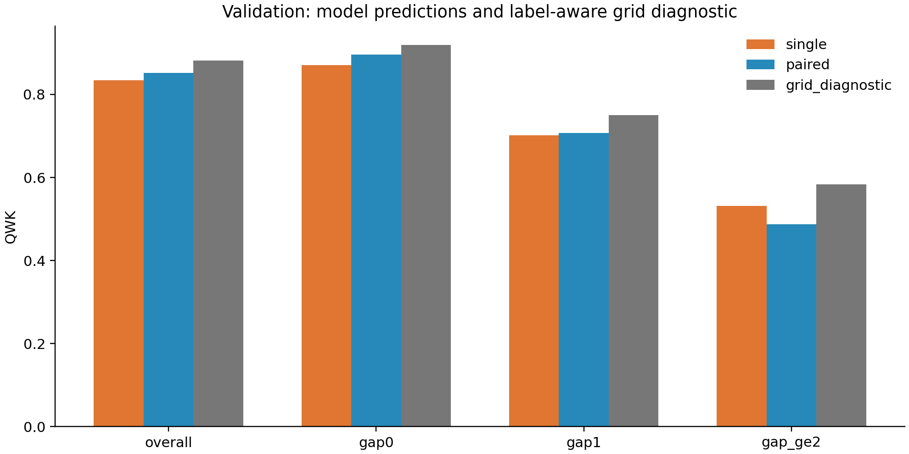
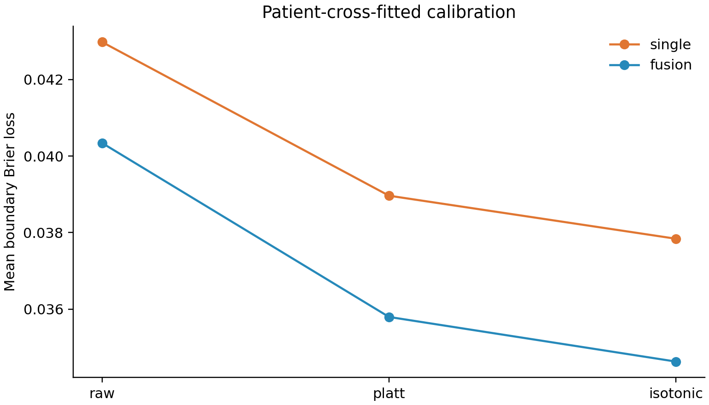

# PHASE 1A: validation review

Status: awaiting human review. OOF and proposed gates have not started.

EyePACS official validation; ConvNeXt-S; seed 42. Expert epochs were selected inside official train.

Calibration and clinical operating points are fit on four patient folds and evaluated on the heldout fifth.
Realized specificity is reported; it need not equal the requested training specificity on heldout data.

## Raw predictions

| Group | Method | Eyes | QWK | Severe under-rate |
| --- | --- | ---: | ---: | ---: |
| overall | single | 10906 | 0.8339 | 0.2935 |
| overall | paired | 10906 | 0.8523 | 0.3103 |
| overall | fixed50 | 10906 | 0.8433 | 0.2998 |
| overall | binary_diagnostic | 10906 | 0.8818 | 0.2453 |
| overall | grid_diagnostic | 10906 | 0.8818 | 0.2453 |
| gap0 | single | 9616 | 0.8711 | 0.2712 |
| gap0 | paired | 9616 | 0.8961 | 0.2740 |
| gap0 | fixed50 | 9616 | 0.8844 | 0.2768 |
| gap0 | binary_diagnostic | 9616 | 0.9191 | 0.2147 |
| gap0 | grid_diagnostic | 9616 | 0.9191 | 0.2147 |
| gap1 | single | 830 | 0.7022 | 0.3373 |
| gap1 | paired | 830 | 0.7072 | 0.3735 |
| gap1 | fixed50 | 830 | 0.7062 | 0.3373 |
| gap1 | binary_diagnostic | 830 | 0.7502 | 0.3133 |
| gap1 | grid_diagnostic | 830 | 0.7502 | 0.3133 |
| gap_ge1 | single | 1290 | 0.6290 | 0.3577 |
| gap_ge1 | paired | 1290 | 0.6120 | 0.4146 |
| gap_ge1 | fixed50 | 1290 | 0.6229 | 0.3659 |
| gap_ge1 | binary_diagnostic | 1290 | 0.6776 | 0.3333 |
| gap_ge1 | grid_diagnostic | 1290 | 0.6776 | 0.3333 |
| gap_ge2 | single | 460 | 0.5313 | 0.4000 |
| gap_ge2 | paired | 460 | 0.4880 | 0.5000 |
| gap_ge2 | fixed50 | 460 | 0.5153 | 0.4250 |
| gap_ge2 | binary_diagnostic | 460 | 0.5839 | 0.3750 |
| gap_ge2 | grid_diagnostic | 460 | 0.5839 | 0.3750 |

## Review these files

- qwk_deltas.csv: paired patient-bootstrap differences (candidate minus reference).
- headroom.csv: squared-error recovery and benefited eyes/patients for label-aware policies.
- boundary_events.csv: boundary support, harmful/beneficial flips and local Teacher B opportunities.
- clinical_operating_points.csv: grade >=2 and severe-or-worse grade >=3 sensitivity, specificity and misses.
- clinical_sensitivity_deltas.csv: clustered sensitivity differences at training-selected operating points.
- predictability_probe.csv: patient-cross-fitted raw-feature logistic probes; compare AP with prevalence.
- shrinkage_association.json and locality.csv: descriptive, grade-adjusted associations.

## Interpretation limits

Binary and finite-grid policies use labels and minimize per-eye squared grade error; neither is a QWK upper bound or a learned result.
Bootstrap intervals are conditional on these trained models and fitted cross-validation predictions; they exclude training/calibrator seed uncertainty.
A zero 0.5-threshold event count does not establish zero ranking/calibration signal.
The predictability probe is exploratory, not the Teacher B gate and not a causal explanation.
Grade >=3 is severe-or-worse DR, not a complete VTDR/DME endpoint.
No automatic +0.005 cutoff or automatic go/no-go decision is used. Review effect sizes, support and uncertainty.
Test predictions are not loaded by this report. Clinical efficacy, novelty and external generalization are not established.

## Before PHASE 1B

Review the report and freeze endpoints, comparator protocol and calibration choices before test access.
Explicit continuation: uv run --locked python scripts/run_phase1.py --stage 1b --reviewed-1a
