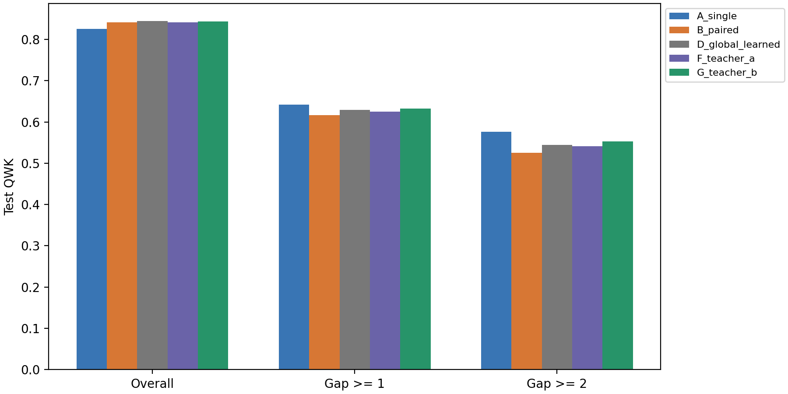

# PHASE 2 result report: seed 123

ConvNeXt-S, seed 123, patient-level five-fold validation cross-fitting.

Proposed arm fixed before test: G_teacher_b (one-boundary Teacher B).

| Arm | Overall QWK | Gap >= 1 QWK | Gap >= 2 QWK |
| --- | --- | --- | --- |
| A_single | 0.8255 | 0.6415 | 0.5765 |
| B_paired | 0.8410 | 0.6161 | 0.5257 |
| C_fixed50 | 0.8350 | 0.6336 | 0.5611 |
| D_global_learned | 0.8443 | 0.6296 | 0.5443 |
| E_boundary_task | 0.8453 | 0.6346 | 0.5544 |
| F_teacher_a | 0.8409 | 0.6251 | 0.5408 |
| G_teacher_b | 0.8429 | 0.6328 | 0.5524 |
| global_asymmetry | 0.8408 | 0.6229 | 0.5352 |
| entropy_reliability | 0.8350 | 0.6336 | 0.5611 |

Patient bootstrap intervals quantify sampling uncertainty, not variation across training seeds.
Teacher B labels are local U_b; joint deployed utility is reported separately.
The 16-mask oracle is a diagnostic discrete policy class, not a learned method or a continuous-gate upper bound.
Locality slopes are descriptive and prevalence-adjusted; they do not prove a causal mechanism.
No external comparator paper has been reproduced by the generic reliability baseline.
This is one PHASE 2 replication seed; interpret it with the multi-seed aggregate.
