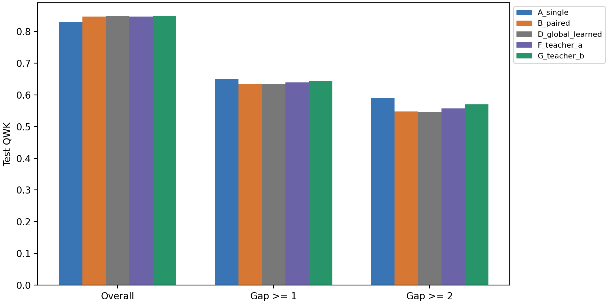

# PHASE 2 result report: seed 128

ConvNeXt-S, seed 128, patient-level five-fold validation cross-fitting.

Proposed arm fixed before test: G_teacher_b (one-boundary Teacher B).

| Arm | Overall QWK | Gap >= 1 QWK | Gap >= 2 QWK |
| --- | --- | --- | --- |
| A_single | 0.8293 | 0.6496 | 0.5890 |
| B_paired | 0.8468 | 0.6342 | 0.5478 |
| C_fixed50 | 0.8397 | 0.6451 | 0.5765 |
| D_global_learned | 0.8473 | 0.6340 | 0.5469 |
| E_boundary_task | 0.8499 | 0.6420 | 0.5638 |
| F_teacher_a | 0.8465 | 0.6389 | 0.5569 |
| G_teacher_b | 0.8476 | 0.6439 | 0.5700 |
| global_asymmetry | 0.8461 | 0.6365 | 0.5501 |
| entropy_reliability | 0.8397 | 0.6451 | 0.5765 |

Patient bootstrap intervals quantify sampling uncertainty, not variation across training seeds.
Teacher B labels are local U_b; joint deployed utility is reported separately.
The 16-mask oracle is a diagnostic discrete policy class, not a learned method or a continuous-gate upper bound.
Locality slopes are descriptive and prevalence-adjusted; they do not prove a causal mechanism.
No external comparator paper has been reproduced by the generic reliability baseline.
This is one PHASE 2 replication seed; interpret it with the multi-seed aggregate.
